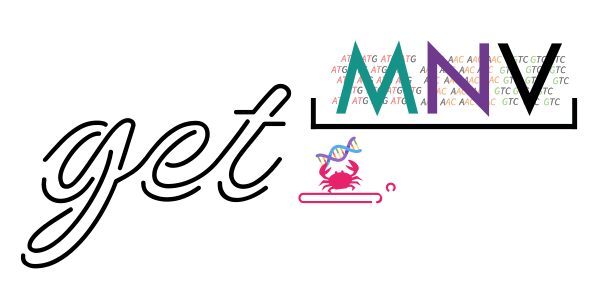

<p class="hero-mark"><picture><source media="(prefers-color-scheme: dark)" srcset="assets/logo-dark.svg"></picture></p>

# get_MNV

Detección de variantes multinucleotídicas a nivel de codón y anotación de
indels, desde un VCF o un TSV de iVar. Rust puro, sin dependencias de C, en
macOS, Linux y Windows.

**[Empieza aquí](getting-started.es.md)** · [Ver un informe real](assets/example-report.html)

get_MNV detecta los casos en los que dos o más SNV caen en el **mismo codón** y
deben interpretarse de forma conjunta. Estos cambios combinados pueden producir
un efecto sobre el aminoácido distinto al de los SNV por separado.


## El problema, en un codón

Es la figura de arriba, en palabras. Un codón lee `CGT` y codifica arginina, y un
llamador de variantes informa de dos sustituciones dentro de él:

| Leído como | Codón | Aminoácido |
|---|---|---|
| Referencia | `CGT` | Arg |
| Solo la posición 1, `C>T` | `TGT` | Cys |
| Solo la posición 2, `G>C` | `CCT` | Pro |
| **Las dos juntas** | `TCT` | **Ser** |

Un anotador que toma cada sustitución por separado informa de una cisteína y de
una prolina. No ocurre ninguna de las dos. Si los dos cambios están en la misma
molécula, la proteína lleva una serina, que es la respuesta que da get_MNV.

Si de verdad están en la misma molécula es otra pregunta, y con un BAM get_MNV
cuenta las lecturas que llevan los dos en vez de darlo por hecho:
mira [Ligamiento](linkage.es.md).

## Qué hace con ellas

| Paso | Qué lee | Qué produce |
|---|---|---|
| 1. Descomponer | la pareja `REF`/`ALT` de cada registro | los cambios individuales que contiene: SNV, MNV, inserción, deleción, delins |
| 2. Situar | la referencia y la anotación de genes | en qué feature cae cada cambio, y en qué codón |
| 3. Traducir | el codón entero, no una base cada vez | el aminoácido que da de verdad ese codón |
| 4. Contar *(con un BAM)* | las lecturas alineadas | cuántas llevan cada cambio, y si viajan juntos |
| 5. Escribir | todo lo anterior | un TSV, un VCF y un informe HTML autocontenido |

Los pasos 1 a 3 no necesitan lecturas. Un BAM solo añade el paso 4, que es el que
convierte "estos dos cambios están en un codón" en "estos dos cambios están en una
misma molécula".

## Qué necesita

| Entrada | Formato |
|---|---|
| Llamadas de variantes | VCF o iVar `variants.tsv` |
| Secuencia de referencia | FASTA |
| Anotación de genes | GFF/GFF3/GTF o un TSV simple |
| Lecturas alineadas *(opcional)* | BAM, para contar el soporte de SNP/MNV/indel |

Escribe las variantes anotadas en TSV, VCF o ambos.

## Características principales

- Agrupa los SNV por codón y reporta llamadas **SNP**, **MNV** o **SNP/MNV**.
- Recalcula los cambios de aminoácido a partir del **haplotipo completo del codón**.
- Descompone los alelos `REF/ALT` en componentes SNV, MNV, inserción, deleción,
  delins e indels complejos.
- Lee VCF e iVar TSV, incluida la notación de indels `+SEQ` / `-SEQ` de iVar.
- Usa las lecturas del BAM (cuando se aportan) para el soporte de SNP/MNV, el
  soporte exacto de eventos indel y el sesgo de hebra.
- Admite 9 tablas de código genético del NCBI.
- Escribe un informe HTML interactivo y autocontenido:
  [ver un ejemplo](assets/example-report.html).
- Incluye una GUI de escritorio para análisis con arrastrar y soltar.

## Instalación

### GUI de escritorio

Descarga la última versión para tu plataforma desde la
[página de Releases](https://github.com/PathoGenOmics-Lab/get_MNV/releases/latest).

> [!NOTE]
> **Usuarios de macOS**
>
> La app no está firmada con un certificado de Apple Developer. En el
> primer arranque, haz clic derecho en la app → **Abrir** → pulsa
> **Abrir** en el diálogo.

> [!TIP]
> **Comprueba lo que has descargado**
>
> Cada versión publica un fichero `SHA256SUMS` que cubre todos sus
> binarios. Descárgalo junto al fichero que quieras y compruébalos juntos:
>
> ```bash
> sha256sum --ignore-missing -c SHA256SUMS
> ```
>
> En macOS, donde `sha256sum` ha llegado hace poco, `shasum -a 256
> --ignore-missing -c SHA256SUMS` hace lo mismo y ha estado ahí siempre.
>
> Cada fichero que encuentre imprime `OK`. Cualquier otra cosa significa
> que la descarga está incompleta o que no es el fichero que publicó la
> versión.

### Línea de comandos

```bash
conda install -c bioconda get_mnv
```

O compílala desde el código fuente, con Rust 1.89 o posterior:

```bash
git clone https://github.com/PathoGenOmics-Lab/get_MNV.git
cd get_MNV
cargo install --path .
```

## Inicio rápido

```bash
get_mnv \
  --vcf variants.vcf \
  --fasta reference.fasta \
  --gff genes.gff3
```

Hay un conjunto de datos de *M. tuberculosis* listo para usar (referencia, genes,
VCF y un BAM de demostración minúsculo para el visor de lecturas) en la carpeta
[`example/`](https://github.com/PathoGenOmics-Lab/get_MNV/tree/main/example)
del repositorio.

## Por dónde seguir

- **[Tutorial de línea de comandos](getting-started.es.md)**: Una primera ejecución completa con los datos de ejemplo, con la salida explicada línea a línea.
- **[Recetas habituales](usage.es.md)**: Comandos listos para ejecutar: una cohorte, una tabla de iVar, un VCF comprimido, un informe a partir de ejecuciones ya hechas.
- **[Referencia de CLI](cli-reference.es.md)**: Cada opción con su valor por defecto, y qué cambia cada una en la respuesta.
- **[Formatos de salida](output-formats.es.md)**: Qué significa cada columna del TSV, cada clave INFO del VCF y cada campo JSON, y cuándo un valor está ausente en vez de valer cero.
- **[Ligamiento](linkage.es.md)**: Distinguir un haplotipo real de dos variantes que solo comparten codón, usando las moléculas que las llevan.
- **[Resolución de problemas](troubleshooting.es.md)**: Los desajustes de entrada que paran una ejecución, y qué pide cada mensaje.

## Cita

Si usas get_MNV, cítalo mediante su
[DOI de Zenodo](https://doi.org/10.5281/zenodo.13907422).

## Licencia

get_MNV se distribuye bajo la licencia **AGPL-3.0**.
